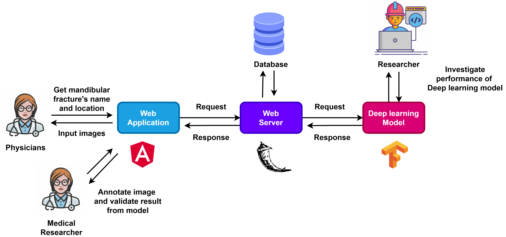

    
    My name is Phrugsa (Pruk-sa).
    
    I am particualrly interested in how intelligent systems can learn, reason, and generalise beyond limited training data and small supervisation. My work sits at the intersection of machine learning research and real-world system design with an emphasis on building AI that is both principled and deployable.

    I hold an MSc in Artificial Intelligence from the University of Essex, where I worked on predictive modelling, generative modelling, and large language models. My research interests include generative models, AI agents, and robotics, with a particular focus on reasoning, generalisation, and System-2 thinking. I am currently exploring Joint Embedding Predictive Architectures (JEPA) and Energy-Based Models (EBMs) as methodologies to move beyond purely data-hungry approaches and toward more robust, adaptable, and compositional learning.

    Before and alongside my research work, I gained industry experience as a software engineer and quality engineer, working within Agile development frameworks to design and maintain scalable systems based on microservices and API architectures, while ensuring reliability through both automated and manual testing. This background informs my research perspective to value not only theoretical possibility but also the implementability, empirical evaluation, and long-term sustainability of proposed methods in real-world settings.

    I currently work as an Analyst Developer at the University of Bedfordshire, where I contribute to AI-driven cloud systems that support the digital transformation of enterprise platforms. My role involves integrating modern AI methods with cloud infrastructure to improve efficiency and decision-making at scale.

    In parallel, I am an open-source contributor, a freelancer helping start-ups leveraging AI capabilities into their products and workflows, and technical writer publishing in-depth articles for leading AI publications on Medium. I enjoy translating complex ideas into clear explanations without losing technical depth. I am open to research collaborations, particularly on projects with meaningful societal impact.

<!-- 

    I am passionate to apply my skills in AI, software engineering, and QA to design efficient and reliable intelligence systems. Before starting my master’s program, I worked as a software engineer building robust and scalable software through microservices and API integration. I also gained experience as a quality engineer conducting both manual and automated testing to maintain rigorous software quality. My career has included roles at global IT consulting firms, where I contributed to Agile projects and collaborated with cross-functional teams. With a solid foundation in both software development and quality assurance, I am now eager to deepen my expertise in AI. After completing my master’s degree, I look forward to utilizing my expertise to create cutting-edge AI-powered solutions and advancing my research capabilities in Cognitive AI and AI reasoning.

 -->
 

<!--

 -->

<!-- 

 -->

Industry-based Project Interest
-------------------------------------

    My industry-based project interests align with developing AI-driven software solutions to address business challenges and foster growth. My primary focus is on creating software that seamlessly integrates generative and agentic AI to optimize and enhance business processes. I also aim to develop user-friendly solutions that can solve real-world challenges, making them more accessible and convenient for users without a technical background.

 

    

 

One example is <a href="https://github.com/phrugsa-limbunlom/PickSmart">PickSmart</a>, an AI-powered shopping assistant that combines real-time product search with contextual question-answering to provide personalized product recommendations through a search and analyst agent.

 

    <iframe src="https://www.linkedin.com/embed/feed/update/urn:li:ugcPost:7299436712282255360" height="300" width="360" frameborder="0" allowfullscreen="" title="Embedded post"></iframe>

Other Projects
-------------------------------------
<ul style="font-size: 15px;">
    <li><a href="https://github.com/phrugsa-limbunlom/DressMe.AI">DressMe.AI: Multimodal Agent with Image Generation</a></li>
    <li><a href="https://github.com/phrugsa-limbunlom/SEAD-agent">SEAD-Agent: AI Research Assistant with Tool Calling</a></li>
    <li><a href="https://github.com/phrugsa-limbunlom/vlm-lora">Low-rank adaptation in VLMs with LLaVA</a></li>
    <li><a href="https://github.com/phrugsa-limbunlom/llm-ptq">8-bit Post-Training Quantization (PTQ)</a></li>
    <li><a href="https://github.com/phrugsa-limbunlom/sagemaker-llm-deployment">LLM Deployment on AWS Sagemaker</a></li>
    <li><a  href="https://github.com/phrugsa-limbunlom/densenet201-classifier">Wildfire Classification from Satellite Images using DenseNet201 model</a></li>
     <li><a  href="https://github.com/phrugsa-limbunlom/multi-regressor-ann">2D-landing Control System with Artificial Neural Network</a></li>
    <li><a  href="https://github.com/phrugsa-limbunlom/mimo-regressor">Feature-Driven Optimization of Syngas Production in Biomass Gasifiers using Machine Learning</a></li>
    <li><a  href="https://github.com/phrugsa-limbunlom/transformer-machine-translation">Machine Translation from Transformer architecture</a></li>
</ul>

Paper
--------------------------------------
<ul style="font-size: 15px;">
    <li><a  href="https://doi.org/10.36227/techrxiv.175742717.74182135/v1">P. Limbunlom, Deep Adversarial Learning for Financial Time-Series Forecasting: An RNN-Based Sentiment-Aware GAN Approach (SE-GAN), TechRxiv, Sep. 9, 2025, doi: 10.36227/techrxiv.175742717.74182135/v1.(Preprint).</a></li>
</ul>

Published Articles
--------------------------------------
<ul style="font-size: 15px;">
    <li><a  href="https://medium.com/towards-artificial-intelligence/training-your-reasoning-model-with-grpo-a-practical-guide-for-vlms-post-training-with-trl-266411c0b844">Training your reasoning model with GRPO: A practical guide for VLMs Post Training with TRL</a></li>
    <li><a  href="https://medium.com/ai-advances/choosing-the-right-model-size-to-your-memory-understanding-bits-bytes-and-model-quantization-6045f8fc68c3">Choosing the right model size to your memory: Understanding bits & bytes and Model Quantization</a></li>
    <li><a  href="https://medium.com/@phrugsa-limbunlom/lora-in-vision-language-models-efficient-fine-tuning-with-llava-c8948674d855">LoRA in Vision Language Models: Efficient Fine-tuning with LLaVA</a></li>
    <li><a  href="https://phrugsa-limbunlom.medium.com/a-straightforward-method-for-creating-auto-tool-calling-agents-bcbef40bf505">A Simple Method For Building Auto-Tool-Calling Agents Without Frameworks</a></li>
    <li><a  href="https://medium.com/towards-artificial-intelligence/document-summarization-qa-in-rag-without-frameworks-pymupdf-chromadb-5446c6373579">Document Summarization & QA in RAG without Frameworks (PyMuPDF & ChromaDB).</a></li>
    <li><a  href="https://phrugsa-limbunlom.medium.com/what-you-may-miss-about-the-core-concept-of-the-gan-model-f1820d3f7efc">The Core Concept of the GAN model: An Insight from Financial Forecasting Research</a></li>
    <li><a  href="https://phrugsa-limbunlom.medium.com/key-takeaways-ai-infrastructure-and-operations-fundamental-by-nvidia-ea7742f0e348">Key Takeaways: AI Infrastructure and Operations Fundamental by NVIDIA.</a></li>
</ul>

Research Interest
-------------------------------------

    My research interest focuses on enhancing cognitive functions in current machine intelligence systems. This interest was motivated by my previous work, where I observed that models often struggle with requiring vast amounts of data for training and fail to generalize to unseen data that deviates from the training distribution (out-of-distribution generalization). After reading the paper,  <a href="https://openreview.net/pdf?id=BZ5a1r-kVsf" style="font-style: italic;"> A Path Towards Autonomous Machine Intelligence </a>, by Yann LeCun, I realized that these issues stem from a lack of reasoning in current models, which need further improvement in their cognitive mechanisms. I am particularly interested in researching approaches to tackle reasoning challenges in large language models (LLMs) and multimodal systems, especially in vision-related tasks. I am currently exploring the feasibility of leveraging Joint-Embedding Predictive Architecture (JEPA) and energy-based models to address these problems. My goal is to develop an intelligent system that requires a small sample for training to learn new situations.

<!--  

    

  -->

Previous Research
--------------------------------------
 

    SE-GAN: Sentiment-Enhanced GAN for Stock Price Forecasting

    <a href="https://github.com/phrugsa-limbunlom/SeGAN">(SeGAN)</a>

 

    

 

    

 

    Abstract

 

    Stock price prediction is a challenging task due to the inherent volatility of the market and the complexity of price movement. Traditional models still encounter limitations when faced with restricted historical data, which leads to over-fitting problems and poor performance on unseen data. Furthermore, market sentiment is a crucial factor for price fluctuations, yet several models still fail to adequately capture this important factor. To address the issues, the research proposes a novel deep learning network architecture. The approach leverages generative adversarial networks (GANs) to expand the training set and generalize on unseen data by generating synthetic historical data. As the GAN model generates prediction of closing prices, the generated prices can be compared with actual market movements to assess its performance. To capture the impact of market sentiment, the model also integrates sentiment analysis from financial news. This integration allows a more comprehensive technique for price forecasting, considering both quantitative historical data and qualitative sentiment indicators. The model was trained on historical data of Microsoft stock (MSFT) from January 2013 to December 2023. To conduct market sentiment analysis on financial news, FINBERT will be utilized to extract sentiment scores from headlines. Additionally, various index of Microsoft stock (MSFT) are integrated in the training data. The proposed model, Sentiment-Enhanced GAN (SE-GAN), integrates sentiment analysis with generative adversarial networks (GANs) to generate more robust and accurate stock price predictions. The SE-GAN model demonstrates the lowest Root Mean Square Error(RMSE) for overall experiment setting compared to baselines models including Long Short- Term Memory (LSTM) and Gated Recurrent Unit (GRU), as well as TimeGPT as another generative model. The improvement suggests that the SE-GAN approach offers a more effective method for predicting stock prices, leveraging the combined strengths of sentiment analysis and generative adversarial networks (GANs).

 

    

 

    <strong>Keywords</strong>: Stock Price Prediction, Sentiment Analysis, Generative Adversarial Networks (GANs), FINBERT

 
 

    MANDY: Empirical Investigation And Supporting Program For Mandibular Fracture Classification And Localization Algorithms On X-ray Images Of Skulls

    <a href="https://github.com/phrugsa-limbunlom/GradCAM/tree/master">(GradCAM)</a>

 

    

 

    Abstract

 

Traffic accidents are a serious situation in Thailand. These accidents are prevalent and lead to a number of patients encountering fractures on their facial skulls. The mandible is a prominent bone in the face that is relatively easy to break, and although treatment can be effective, doctors need to know the fracture locations immediately to reduce the risk of other injuries. Diagnoses of the fractures is normally done by X-Ray due to its inexpensive cost. However, locating fractures in the mandible using X-Ray film can be difficult and often requires the opinion of  specialists. As such, a computer-aided diagnostic tool would lead to faster, more accurate, and less costly analysis. To our knowledge, no research has been undertaken on the effectiveness of such technology in mandibular fracture detection from X-Ray images. This research aims to investigate relevant models for images classification using convolutional neural networks (CNNs) and transferring techniques from pre-trained models to identify the names of mandibular fracture, also employ Gradient-weighted Class Activation Mapping (GradCAM) to localize the location of those fractures on x-ray images. Moreover, the trained model was deployed to create a diagnostic system helping non-specialist doctors diagnose mandibular fractures more accurately and efficiently without requiring a reference to specialists, as well as support medical research to study the effectiveness of web applications in clinical practice.

 

    <video width="360" height="180" controls>
    <source src="Mandy.mp4" type="video/mp4">
    </video>

 

    <strong>Keywords:</strong> Convolutional Neural Network, GradCAM, Mandibular Fracture, Classification, Localization, X-ray Image

Education
--------------------------------------

    MSc, Artificial Intelligence and its Applications, CSEE, University of Essex (Distinction)

    BSc, Major Computer Science, Faculty of ICT, Mahidol University (3.62/4.00)

    Certificate of Completion, Artificial Intelligence (87%), ISS 2019, Sungkyunkwan University

Certificates
---------------------------------------
<ul style="font-size: 15px;">
<li> AWS Certified: Machine Learning Engineer Associate (MLA-C01)</li>
<li> Microsoft Certified: Azure AI Engineer Associate (AI-102)</li>
<li> IBM Generative AI Engineering with LLM Specialization </li>
<li> NVIDIA AI Infrastructure and Operations Fundamentals </li>
<li> Deep Learning Specialization</li>
<li> AWS Cloud Practitioner</li>
</ul>

    
    
    

Awards
---------------------------------------
<ul style="font-size: 15px;">
    <li>Academic Excellence International Master Scholarship from University of Essex</li>
    <li>The Big Essex Bronze Award 2024 from University of Essex</li>
    <li>Winner Award for Outstanding Innovation in <i> Free smoking university project 2019 </i> issued by The Medical Association of Thailand from <i><a href="https://github.com/phrugsa-limbunlom/Cigarless/tree/main"> CIGARLESS </a> </i> application</li>
</ul>

More About Me
----------------------------------------

    I am passionate about cutting-edge technology and fascinated by how the industry drives core development while leveraging its capabilities to create applications serving real users effectively.
    Apart from technology, I like science, evolution, and history. Visiting museum is my another hobby.

 

